# Sheiko Task Lifecycle

An Obsidian plugin that works **alongside [TaskNotes](https://github.com/callumalpass/tasknotes)**. It tracks each task's lifecycle, prompts you to sign off tasks in review, and rolls unfinished tasks to the next day.

> **Status: early release (v0.2.4), desktop only.** Plugin ID `sheiko-task-lifecycle`. Tested against TaskNotes **4.13.4**. Listed in the [Obsidian Community directory](https://community.obsidian.md/plugins/sheiko-task-lifecycle).

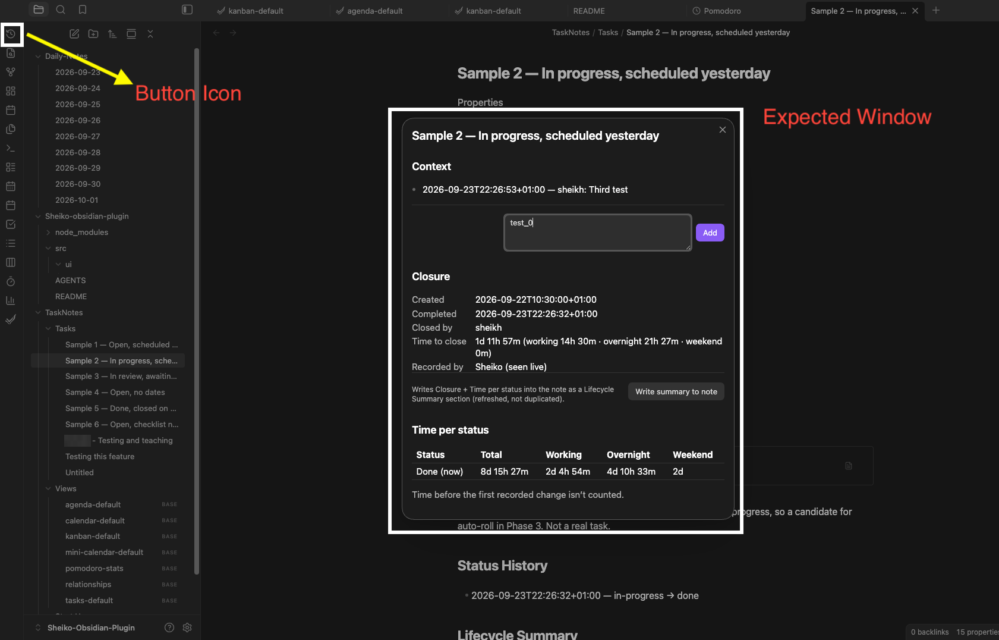

*Click the ribbon icon (history clock) on a TaskNotes task to open the lifecycle window. Screenshots are from the developer's test vault: sample task names are test data and may not match the task's current status, and some settings differ from the defaults below.*

**Contents:** [How it fits together](#how-it-fits-together) · [Working with AI agents](#working-with-ai-agents) · [Before you start](#before-you-start-what-sheiko-changes-in-your-vault) · [Getting started](#getting-started) · [Requirements](#requirements) · [Compatibility](#compatibility) · [Lifecycle tracking](#1-lifecycle-tracking) · [Auto-stage and sign-off](#2-auto-stage-and-sign-off) · [Auto-roll](#3-auto-roll) · [Breaks and deep work](#4-breaks-and-deep-work) · [Commands](#commands) · [Settings](#settings) · [Known limits](#known-limits) · [Development](#development)

## How it fits together

⚙️ marks a switch in Sheiko's settings, with its default. The checkbox move and both sign-off prompts also need a review status (see [Getting started](#getting-started), step 4).

### A task's journey

<picture>
  <source media="(prefers-color-scheme: dark)" srcset="https://raw.githubusercontent.com/Ashura-Sheikh/Sheiko-obsidian-plugin/HEAD/docs/diagrams/journey-dark.png">
  
</picture>

Every step is recorded in the task note: status changes in `## Status History`, notes and sign-offs in `## Context` (sign-offs can go in frontmatter instead, a setting), and time per status in `## Lifecycle Summary`. Automatic moves only go forward, and **closing is always a click by you, never automatic.**

### Feature map

<picture>
  <source media="(prefers-color-scheme: dark)" srcset="https://raw.githubusercontent.com/Ashura-Sheikh/Sheiko-obsidian-plugin/HEAD/docs/diagrams/feature-map-dark.png">
  
</picture>

### Working with AI agents

Colours show who acts: orange for AI agents, blue for Sheiko, green for you. The prompt step assumes the default switches and a review status set (see [Getting started](#getting-started), step 4).

The diagrams' Mermaid source is in [`docs/diagrams/`](docs/diagrams/).

## Before you start: what Sheiko changes in your vault

Sheiko edits your notes, so it starts switched off and stays cautious:

- **It does nothing unless TaskNotes is installed and enabled.** No tracking, no auto-roll, no prompts. If you enable TaskNotes later, reload Obsidian.
- **It writes nothing until you allow the current vault** (Settings → Sheiko Task Lifecycle → Safety → *Allow writes in this vault*). Until then it's read-only.
- **Auto-roll is off by default.** Turn on *Dry run* first to see what it would change, then switch auto-roll on. Dry-run output goes to the developer console (Ctrl/Cmd+Shift+I) at the *Verbose* log level.
- **Each batch run is capped** at 25 edited notes by default (*Max edits per run*). The rest are picked up on the next run.

Once allowed, it writes only to these places:

| Where | What |
|---|---|
| Task notes, frontmatter | `completedDate`, `closedBy`, `timeToCloseMinutes`, `timeWorkingMinutes`, `timeOvernightMinutes`, `timeWeekendMinutes`, `closureSource`, `scheduled`, `rollCount`, `status`, and `signedOff` / `signedOffBy` if you choose the field form for sign-offs (names are a setting) |
| Task notes, sections | `## Context`, `## Status History`, `## Lifecycle Summary` |
| Task notes, checkbox lines | Ticking or unticking a box from the checklist window changes that box (`[ ]` ↔ `[x]`) on its line, in any section the window allows. Nothing else on the line changes. |
| That day's daily note | `## 🔁 Rolled Over`, when auto-roll runs. The note is created if it doesn't exist. |
| Report notes | Only if you use break or deep-work slots: one note per day in a report folder (default `Sheiko Reports/`), named by date, e.g. `Sheiko Reports/2026-10-06.md`. Each slot adds a block; earlier blocks are never changed. No slots, no report notes. |

To find TaskNotes tasks it looks through the vault's Markdown files (Obsidian's directory lists this as "vault enumeration"), but it only edits the places above. **It never sends data anywhere:** no network use, no telemetry.

## Getting started

1. Install and enable [TaskNotes](https://github.com/callumalpass/tasknotes), then this plugin.
2. In this plugin's settings, switch on **Allow writes in this vault**.
3. Optional: enter **Your identity**. It's written as `closedBy` on closes Sheiko records. Left blank, `closedBy` isn't written.
4. Optional, for the sign-off flow: add a review status (e.g. `in-review`) in TaskNotes' settings, then pick it as **Review status** here. Until a review status is picked, the checkbox move and both sign-off prompts stay off.
5. Optional: set your **working hours**, try **Dry run**, then switch on **auto-roll**. If TaskNotes' *scheduled-date rollover* workflow is on, use only one of the two, or tasks will move twice (see [Compatibility](#compatibility)).

## Requirements

- Obsidian **1.4.4+**, desktop only
- **TaskNotes** installed and enabled (tested on 4.13.4)
- Obsidian's Daily Notes settings (folder and date format) are used for the Rolled Over summary

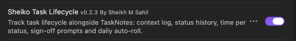

## Compatibility

- **TaskNotes Workflows:** its optional *scheduled-date rollover* workflow and Sheiko's auto-roll both move `scheduled` forward. Use one or the other, not both, or tasks will move twice.

## 1. Lifecycle tracking

### Context log and status history

<!-- Screenshot to add (issue #15): a task note's ## Context and ## Status History sections. -->

- **Context log:** an append-only `## Context` section in each task note. Entries look like `- **{timestamp} — {who}:** {text}`. The `— {who}` part is left out when no identity is set.
- **Status history:** an append-only `## Status History` section with ISO-timestamped changes. Clicking the same status again isn't logged.

### Closure fields

- `completedDate` (full ISO), `closedBy` (only if an identity is set) and `timeToCloseMinutes` are written **only for a close Sheiko saw happen live**.
- Sheiko never overwrites a closure field already there, whether written by hand, by an AI agent or by another tool. On a live close it fills only the **blank** ones. That includes `closedBy`, set to your identity even when someone else, such as an agent, closed the task ([#19](https://github.com/Ashura-Sheikh/Sheiko-obsidian-plugin/issues/19)).
- If Sheiko filled any field, it marks the note `closureSource: sheiko`. A reopen then clears **all** the closure fields on that note, including ones it didn't write ([#19](https://github.com/Ashura-Sheikh/Sheiko-obsidian-plugin/issues/19)). A note without that mark is left alone on reopen.

### Time per status, in three buckets

Time is split into working hours, overnight and weekend: `timeWorkingMinutes`, `timeOvernightMinutes` and `timeWeekendMinutes`. The three always add up to `timeToCloseMinutes`.

### Lifecycle Summary

<!-- Screenshot to add (issue #15): a task note's ## Lifecycle Summary section. -->

A `## Lifecycle Summary` section (closure plus time per status), refreshed in place. It's written automatically on a live close, or on demand.

- Times under an hour show seconds (`9s`, `6m 28s`); longer ones show `2h 5m`, `1d 3h`. The frontmatter fields stay in whole minutes.
- For a close Sheiko didn't see live, the time to close and its split are worked out from Created and Completed, and marked as worked out.
- Missing data shows `—`, never `0m`.

The lifecycle window (top of this page) shows the same closure and time per status, plus the Context log.

### Startup catch-up

- Status changes made while Obsidian was closed are logged as "detected at startup", never given an invented time.
- Time spent in a status that was skipped over is shown as a **gap**, not estimated.
- Closes Sheiko didn't see happen are listed and flagged, never filled in.

## 2. Auto-stage and sign-off

### Auto-stage (forward only)

<!-- Screenshot to add (issue #15): a task moved by auto-stage, e.g. its Status History lines. -->

- Starting a TaskNotes timer moves the task to the working status.
- Ticking the last unticked checkbox moves it to the review status.
- Moves happen only when something changes, never just because of existing state, and never backwards or out of a completed status.

### The sign-off window

It opens when a task enters review, and at each day's end time for anything still waiting. Cards start folded when more than 3 tasks are waiting.

![The Sign-off needed window next to the checklist pop-out. The window shows a link to 2 signed-off tasks, the age bands (>3h [0], >6h [0], >12h [0], >24h [3]), and cards with Open, Send back, Sign off and Sign off and close, a priority pill, the worker badge and a Checklist 1/3 link. The pop-out shows that task's checklist with one box ticked and Add note beside it](docs/screenshots/signoff-and-checklist.png)

Each task gets a card. The title has its own line; a long title is cut with "…" (hover for the full title). The buttons sit below it.

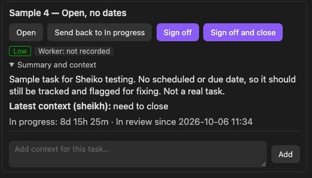

Each card shows:

- **Who worked on it**, read from a frontmatter field (default `assignedTo`). Names you list as AI agents show as *AI agent*, any other name as *Human*, and an empty field as *Worker: not recorded*. It's never guessed.
- **Priority** as a pill, in TaskNotes' own label and colour (0.2.4). No priority, no pill.
- **Summary and context:**
  - the task's description: its first section, shown as formatted Markdown. Template-only lines such as Meta Bind `INPUT[…]` fields are skipped, and long descriptions are collapsed, with *Show more*;
  - the latest Context entry;
  - the facts: time in progress, in review since, checklist progress, due or overdue, and how many times it was sent back.
- **A context box** for a note while you decide. It's saved to the task's Context before *Sign off*, *Sign off and close* or *Send back* runs.

**Buttons:** *Sign off*, *Sign off and close*, *Send back*, *Open*, *Later*. **Closing a task is always a user click, never automatic.**

### Age bands (0.2.4)

Under the window's title (see the first screenshot above): *In review: >3h [n] · >6h [n] · >12h [n] · >24h [n]*.

- The bands don't overlap: 3–6 hours, 6–12, 12–24, over 24.
- They use **clock time** since the task last entered review, nights and weekends included, not working hours.
- Click a band to show only its tasks. Click it again, or *All*, to show everything.
- The hours are a setting.

### Sign off without closing (0.2.4)

*Sign off* records your sign-off and leaves the task in review, for whoever closes it. *Sign off and close* is the old *Approve and close*.

- **The record:** a Context line, `- **<time> — <identity>:** Signed off (not closed)`. Or, if you choose it in settings, frontmatter fields `signedOff` (time) and `signedOffBy` (identity). Both forms are always read, so switching the setting never hides an earlier sign-off.
- **What counts:** only the fixed phrase, **under your own identity** (Settings → *Your identity*; case doesn't matter), made after the task last entered review, while it's still there.
  - A sign-off or withdrawal under any other name, such as a line an AI agent typed into Context, is ignored, in either form. Nobody else can sign off for you or undo your sign-off.
  - A task sent back and returned to review needs signing off again.
  - Free text such as "signing off" in a Context entry isn't read as a sign-off.
- **Needs an identity.** With none set, *Sign off* is greyed out: an anonymous sign-off can't tell anyone who signed.
- **When the task is closed later,** by anyone, Sheiko notes it on the history line: `in-review → done (signed off by <identity> at <time>)`, or `(no sign-off recorded)` if there was no valid sign-off. *Sign off and close* keeps its own note, as before.

### Signed off, waiting to close (0.2.4)

Signed-off tasks leave the sign-off window, its count and the end-of-day prompt. They're listed in their own window. Open it from **✓ N signed off** in the status bar, the link at the top of the sign-off window, or the command palette.

Each task has *Open*, *Withdraw sign-off* (adds a withdrawal line to Context; if the sign-off is in frontmatter fields, those fields are cleared) and *Close now*.

  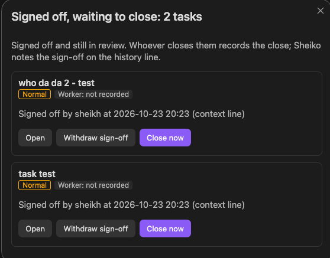
  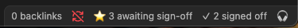

### Checklist window (0.2.4)

*Checklist n/m* on a card opens the task's checklist in its own **pop-out window**, which you can move and resize (shown on the right of the first sign-off screenshot). It's there to make review easier: more of the task in front of you before you make a call or sign off.

- It shows every section of the note that has checkboxes, in full: heading, text and boxes.
- *Open note* opens the note in a new tab in the pop-out, next to the checklist.
- **Ticking writes to the note:** one character on that line, and only if the line hasn't changed since the window drew it. Every tick is logged as a Context line ("Ticked … from the checklist window"), and a ticked box has *Add note* for a comment, also added to Context.
- **Ticks here never move the task.** Ticking the last box from the window doesn't trigger the move to review.
- **Protected sections are view-only:** any heading containing *Pre-Handoff Checklist*, *Necessity check* or *sign-off* (and its sub-headings). Those boxes are someone else's record, such as a self-check or a gate, so they're ticked in the note itself. The list is a setting.
- The window is also view-only with no identity set, writes not allowed in the vault, or dry run on.

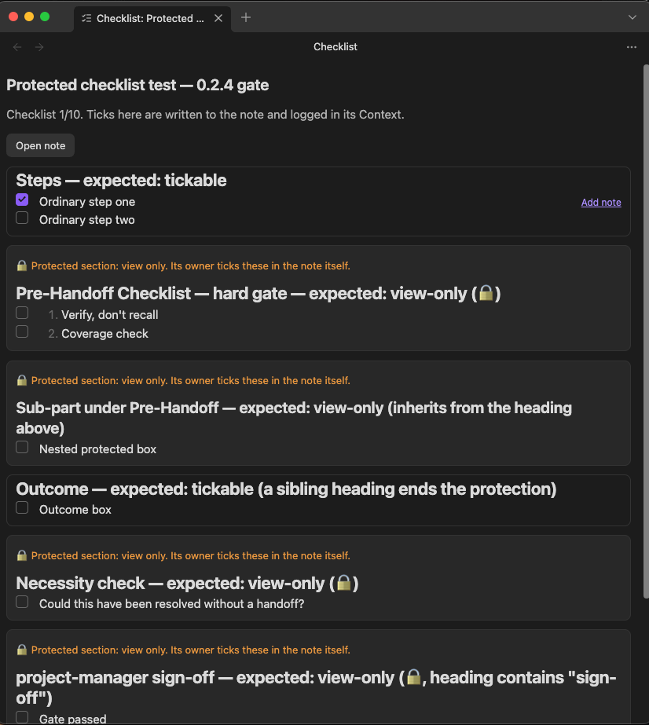

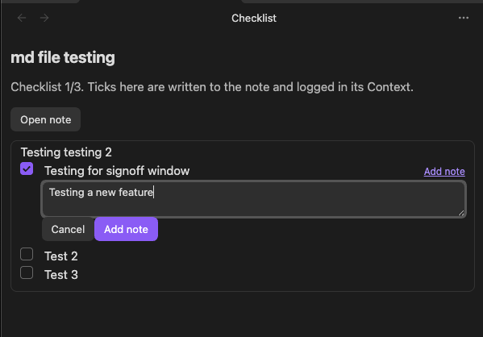

### Coming back to "Later"

The status bar shows **⭐ N awaiting sign-off**. Click it to reopen the window with everything still in review. It's hidden when nothing is waiting, and you can switch it off.

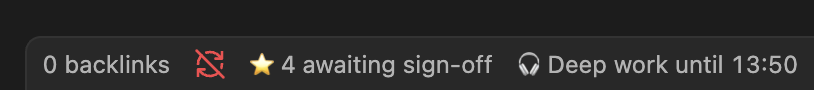

## 3. Auto-roll

At each day's end time (**weekends included**), unfinished tasks scheduled on or before that day have `scheduled` moved to the next day.

- A time of day, if present, is kept.
- **`due` never changes**, so slippage stays visible.
- `rollCount` goes up by one each time.
- **Not rolled:** completed, scheduled in the future, recurring (TaskNotes uses `scheduled` as the repeat anchor) and archived tasks. Tasks with **no date** are listed as "give these a date".
- **Summary, in two places:** a Context line on each rolled task, and a `## 🔁 Rolled Over` section in that day's daily note (one block per run, never overwritten). In-review tasks are listed first (⭐), and past-due tasks are flagged ⚠️.
- If Obsidian was closed at the cutoff, one **catch-up** roll runs on next open, labelled as a catch-up.

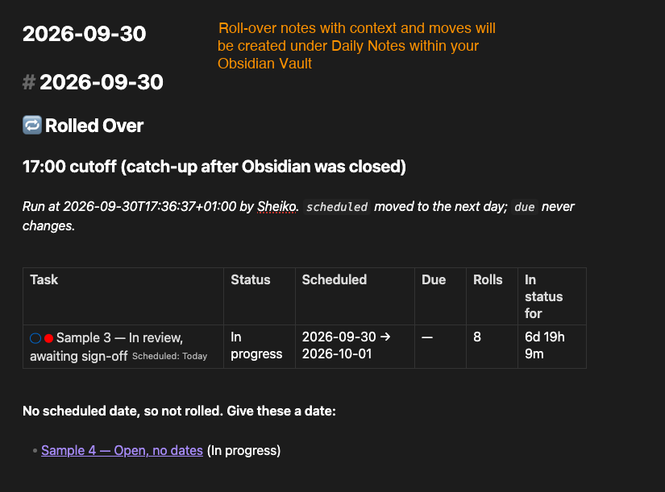

## 4. Breaks and deep work

Start a slot from the 🎧 status-bar item or the command palette, or schedule slots per weekday in settings (e.g. `12:30-13:00 break, 14:00-15:30 deep work`). Break and deep work behave the same way.

  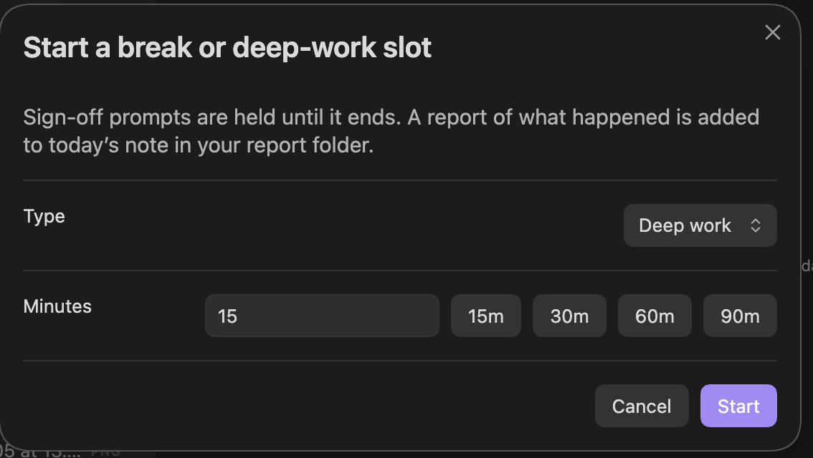
  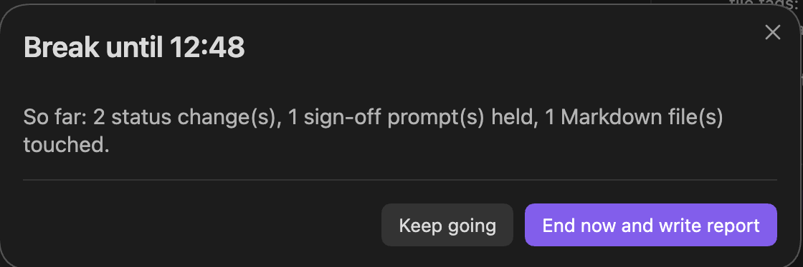

- **While a slot runs,** sign-off prompts are held. Opening the sign-off window yourself still works. Sheiko logs:
  - tasks moved to review;
  - closes and other status changes;
  - tasks whose timed `due` falls inside the slot;
  - Markdown files touched.
- **When it ends,** at its time or early from the status bar, a report block is added to that day's note in the report folder, and held prompts are shown.
- **Time tracking is unchanged.** Slots don't affect the working, overnight and weekend split.
- **"Files touched"** means any Markdown file changed while Obsidian is open, by you or by another plugin. For example, TaskNotes re-saves its board order across a column when a card moves. Changes made while Obsidian was closed, such as by an agent editing files directly, aren't captured, and the report says so. If Obsidian was closed during part of a slot, that stretch is noted as a gap.

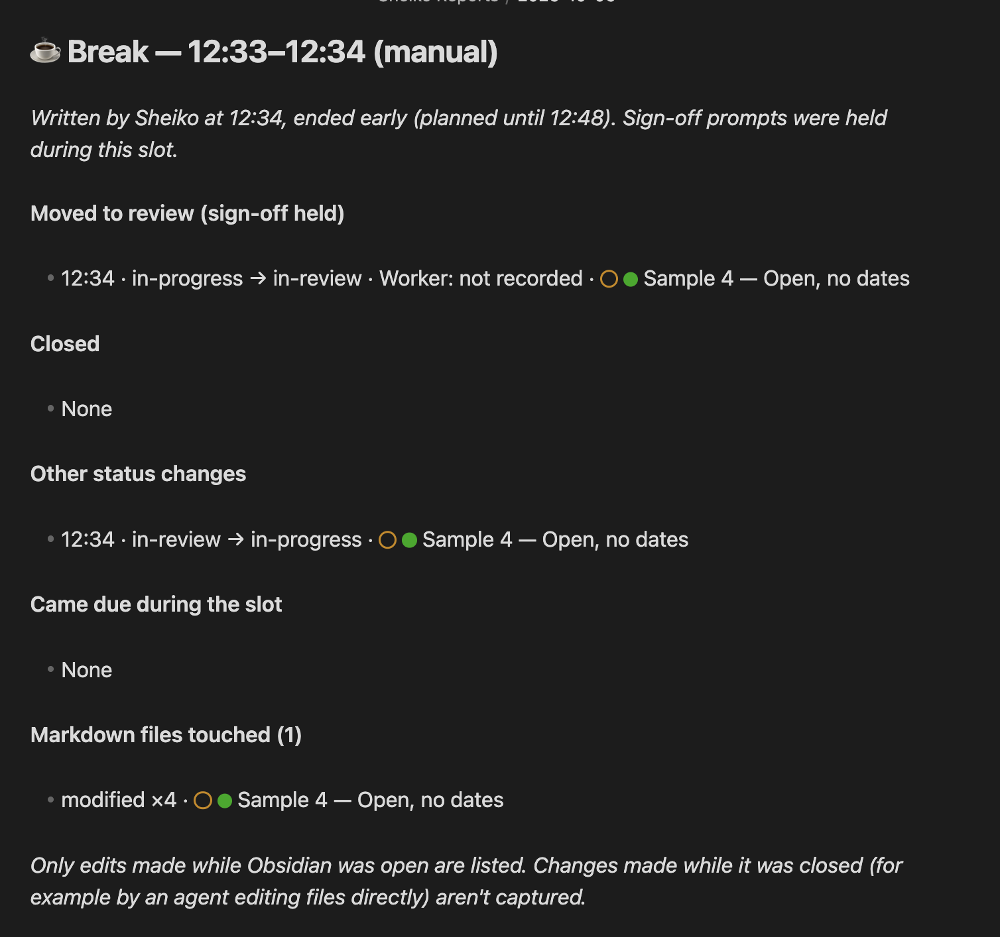

## Commands

- Open task lifecycle (context, closure, time per status). Also opened from the ribbon icon.
- Write lifecycle summary to this task
- Show tasks waiting for sign-off
- Show signed-off tasks waiting to close (0.2.4)
- Roll unfinished tasks now (scheduled today or earlier → tomorrow)
- List tasks closed while Obsidian was shut
- Start a break or deep-work slot
- End the current break or deep-work slot now

The ribbon icon and the lifecycle command need a TaskNotes task open. On any other note you get a notice instead:

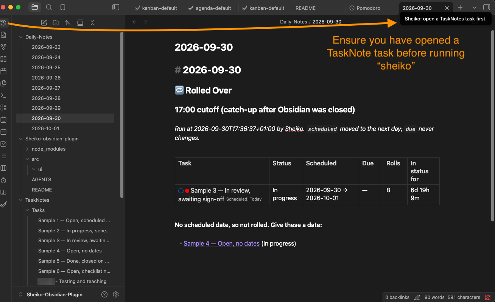

## Settings

Statuses and field names are read from TaskNotes' settings rather than hardcoded. TaskNotes' default statuses don't include a review status, so add one in TaskNotes first if you want the sign-off flow.

### Safety and identity

| Setting | Default | Notes |
|---|---|---|
| Identity | *(blank)* | Written as `closedBy`, in Context entries and on sign-offs. Blank = no `closedBy`, and *Sign off* and checklist ticking are off. |
| Allowed vaults | *(empty)* | **Nothing is written until the current vault is allowed.** |
| Dry run | off | Logs intended writes instead of making them, including the daily note and slot reports |
| Max edits per run | 25 | Caps startup catch-up and auto-roll. Tasks held back are listed and picked up on the next run. |

### Stages and sign-off

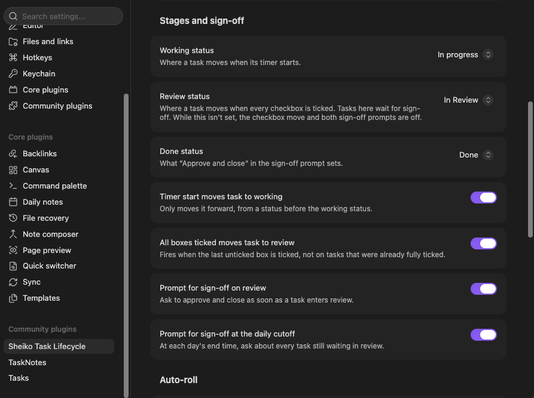

| Setting | Default | Notes |
|---|---|---|
| Working / review / done status | `in-progress` / *(not set)* / `done` | Picked from TaskNotes' own status list. While review is not set, the checkbox move and both sign-off prompts are off. |
| Auto-stage on timer start / all boxes ticked | on / on | Each can be switched off |
| Sign-off prompt on review / at cutoff | on / on | Each can be switched off |
| Show sign-off count in the status bar | on | Click it to reopen the sign-off window. Also shows **✓ N signed off** (0.2.4) |
| Sign-off record | Context line | How *Sign off* is recorded: a Context line, or frontmatter fields. Both are always read (0.2.4) |
| Sign-off field | `signedOff` | For the field form; the identity goes in `<field>By` (0.2.4) |
| Age bands (hours) | `3, 6, 12, 24` | Rising, comma-separated. Clock time since the task entered review (0.2.4) |
| Protected headings (section *Checklist window*) | `Pre-Handoff Checklist`, `Necessity check`, `sign-off` | One per line, not case-sensitive. Boxes under a heading containing one of these, or under its sub-headings, can't be ticked from the checklist window. Only real headings count, not bold lines (0.2.4) |

### Auto-roll and working hours

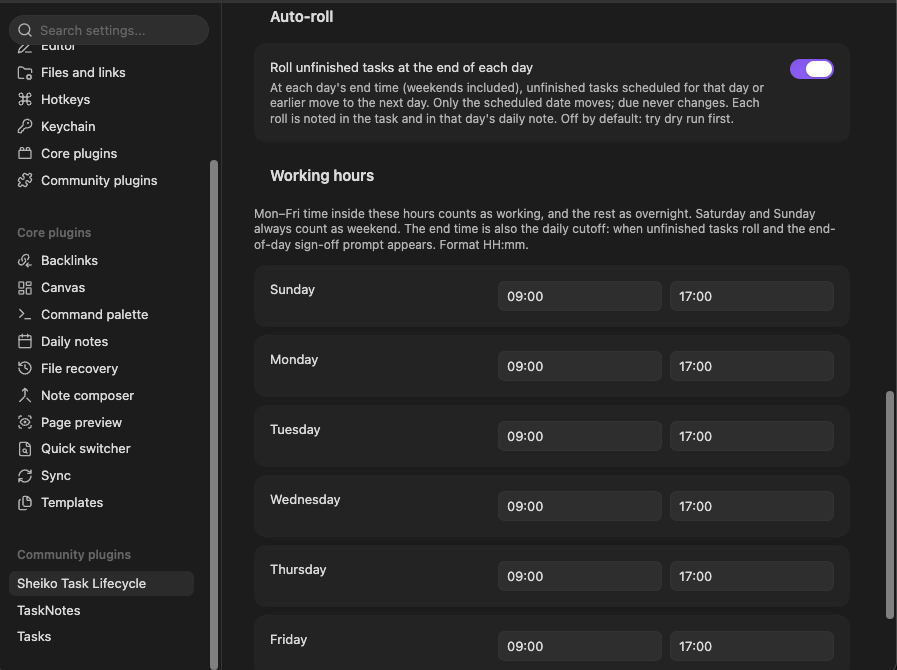

| Setting | Default | Notes |
|---|---|---|
| Auto-roll | off | Try dry run first |
| Working hours (per weekday) | 09:00–17:00, every day | The end time is also the daily roll cutoff. The same window decides the working / overnight / weekend split. |

### Who worked on it, and breaks and deep work

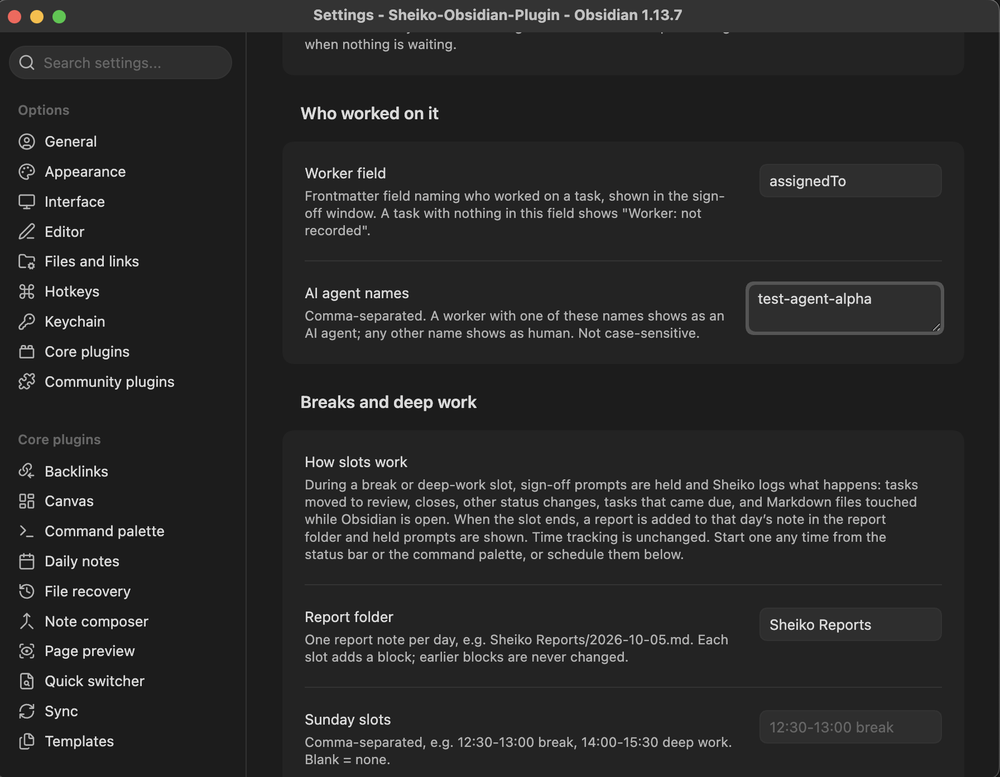

| Setting | Default | Notes |
|---|---|---|
| Worker field | `assignedTo` | Frontmatter field naming who worked on a task |
| AI agent names | *(empty)* | Comma-separated, not case-sensitive. Any other name shows as human |
| Report folder | `Sheiko Reports` | One note per day for slot reports |
| Slots (per weekday) | *(blank)* | e.g. `12:30-13:00 break, 14:00-15:30 deep work`. Blank = none. Bad entries are flagged, not guessed |

## Known limits

**Tracking**

- A task first seen by Sheiko has no earlier history. It's tracked from then on, with nothing backfilled.
- If a close written by an agent or by hand is reopened and then closed again live, the original `closedBy` / `timeToCloseMinutes` are kept, so they can be stale. This applies only if Sheiko didn't mark the note `closureSource: sheiko`; see the next point.
- **A close Sheiko didn't make** (for example, an agent setting a task to done while Obsidian is open) gets its blank closure fields filled, including `closedBy` = your identity. Then, if the task is reopened, all its closure fields are cleared, including the agent's own `completedDate` and `closedBy`. Tracked in [#19](https://github.com/Ashura-Sheikh/Sheiko-obsidian-plugin/issues/19).
- If a task's only recorded status change is the close itself, the Lifecycle Summary's *Time per status* table has no rows.
- Sheiko waits 600 ms after a change so TaskNotes can finish its own writes. That delay is a timing assumption.
- Tested only against TaskNotes 4.13.4. A change to TaskNotes' frontmatter or settings shape could break Sheiko.

**Sign-off**

- **Closing a task from TaskNotes itself** (the status pill, a board drag) is recorded as `(no sign-off recorded)` unless *Sign off* was used first, even when you close it yourself. Sheiko can't tell who changed the status. *Sign off and close* records it as signed off.
- **Changing your identity** means sign-offs made under the old one no longer count.
- **Free-text sign-offs aren't read.** A Context entry such as "Reviewed - signing off" doesn't count; only *Sign off*'s fixed record does. Sign-offs typed before 0.2.4 aren't recognised.
- The worker badge is only as accurate as the worker field. A name not in *AI agent names*, including a typo, shows as *Human*.
- The checklist window reads Markdown checkboxes (`- [ ]`, `1. [ ]`). Boxes inside code blocks, and Sheiko's own sections, aren't shown.

**Breaks and deep work**

- "Came due during the slot" counts only `due` values with a time. Date-only dues are left out.
- If a scheduled slot's start time comes while a slot you started yourself is still running, the scheduled one starts when yours ends, for the rest of its window.
- "Markdown files touched" counts every `.md` file changed while a slot runs, including in code folders kept inside the vault. For example, an `npm install` in a project folder in the vault can add hundreds of files from `node_modules/` to the report.

## Support

See [CONTRIBUTING.md](CONTRIBUTING.md) for how to report bugs and open pull requests. Best effort. Report issues on [GitHub](https://github.com/Ashura-Sheikh/Sheiko-obsidian-plugin/issues). No response-time guarantee. Tested on TaskNotes 4.13.4.

## Development

- Node.js 20+
- `npm i` to install dependencies
- `npm run dev` to build in watch mode (`src/main.ts` → `main.js`)
- `npm run build` to type-check and run a production build
- `npm run lint` for ESLint with the Obsidian plugin rules
- `npm test` to type-check and run the tests

**Loading it in a dev vault:** symlink the repo into the vault as `<vault>/.obsidian/plugins/sheiko-task-lifecycle → <repo>` (the folder name must match the plugin ID), then enable "Sheiko Task Lifecycle" under Community plugins. To install manually instead, copy `main.js`, `manifest.json` and `styles.css` into `<vault>/.obsidian/plugins/sheiko-task-lifecycle/`.

**Naming note:** class names, CSS classes, notices ("Sheiko: …") and the `closureSource: sheiko` value written to task notes deliberately keep the short name "Sheiko". Changing `closureSource` would stop a reopen from clearing closure fields on tasks Sheiko had already closed.

**Source layout (`src/`):**

| File | What it does |
|---|---|
| `main.ts` | Plugin entry, commands, cutoff timer |
| `tracker.ts` | Status-change detection, closure, startup catch-up |
| `lifecycle.ts` | History, time buckets, summary |
| `roll.ts` / `roller.ts` | Auto-roll rules and engine |
| `review.ts` | Sign-off card summaries and worker labels |
| `slots.ts` / `slot-logic.ts` | Break and deep-work slots and reports |
| `tasknotes.ts` | Reading TaskNotes' config, including priorities |
| `signoff-record.ts` | The sign-off rule |
| `signoff-index.ts` | Which review tasks are signed off |
| `age-bands.ts` | Age bands |
| `checklist.ts` | Checklist sections and protection |
| `settings.ts` | Settings |
| `ui/` | Lifecycle, sign-off, signed-off, checklist pop-out and slot windows |

**Tests (`test/`):** 114 tests run the real tracker, auto-roll and slot code against an in-memory vault and a stand-in for the `obsidian` module (`test/obsidian-mock.ts`). They cover the code that edits notes:

- closure fields, reopen, startup catch-up, dry run and the edit limit;
- what does and doesn't roll;
- sign-off summaries, sign-off window routing and card fold state, and sign-off descriptions;
- time-split formatting and rounding;
- slot holds and reports;
- (0.2.4) the sign-off rule in both forms, the signed-off index, age bands, priorities, checklist sections and protection, and the checklist window's guarded line edit.

The repo's build workflow (`.github/workflows/lint.yml`) also runs them.

## Licence

[MIT](LICENSE) © 2026 Sheikh M Sahil

## Credits

Built from the [Obsidian sample plugin](https://github.com/obsidianmd/obsidian-sample-plugin) template. API docs: https://docs.obsidian.md
